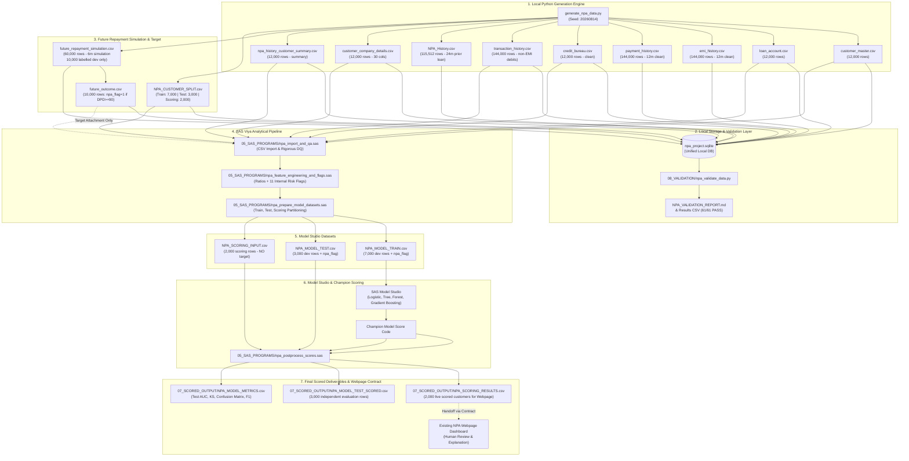

# NPA Early Detection - End-to-End Data Lineage & Architecture

This document details the data provenance, transformation logic, and architectural flow of the synthetic data generation, SAS Viya analytical processing, Model Studio machine learning, and downstream webpage consumption.

---

## 1. End-to-End Architecture & Data Flow

---

## 2. Source-to-Target Feature Transformation Mapping

The analytical base table is built by combining current loan, bureau, transaction, prior history, and company metrics:

| Engineered Feature / Flag | Formula / Transformation Source | Business Rationale & Guardrail |
|---|---|---|
| `emi_income_ratio` | `emi_amount / max(1, monthly_income)` | Installment burden relative to regular income. |
| `outstanding_ratio` | `outstanding_amount / max(1, sanctioned_amount)` | Proportion of principal remaining unpaid. |
| `credit_utilization` | `total_credit_balance / max(1, total_credit_limit)` | Utilization of revolving credit facilities across bureau. |
| `loan_to_value` | `sanctioned_amount / max(1, collateral_value)` | Exposure security coverage ratio. |
| `debt_to_income` | `(emi_amount + (total_debit_transaction / 12)) / max(1, monthly_income)` | Total monthly debt and lifestyle outflow burden. Excludes loan EMI from debit to prevent double-counting. |
| `cash_withdrawal_ratio` | `total_cash_withdrawal / max(1, total_debit_transaction)` | Cash extraction intensity from bank accounts. |
| `credit_to_income_ratio` | `(total_credit_transaction / 12) / max(1, monthly_income)` | Turnover cash-flow velocity relative to declared income. |
| `flag_high_emi_burden` | `emi_income_ratio > 0.40` | Binary trigger for elevated installment commitments. |
| `flag_high_credit_utilization` | `credit_utilization > 0.75` | Binary trigger for near-limit revolving credit usage. |
| `flag_low_credit_score` | `credit_score < 650` | External bureau risk score below prime benchmark. |
| `flag_high_outstanding_ratio` | `outstanding_ratio > 0.85` | Unamortized or seasoned loan with high principal exposure. |
| `flag_previous_npa` | `previous_npa_flag = 1` | Verified default event in historical loan cycle. |
| `flag_prior_missed_streak` | `max_consecutive_missed_months >= 3` | Chronic delinquency streak in previous borrowing history. |
| `flag_company_financial_stress` | `financial_stress_flag_synthetic = 1` | Associated employer/business under synthetic financial strain. |
| `flag_negative_turnover_growth` | `turnover_growth_pct < -5.0` | Revenue contraction in customer's commercial ecosystem. |
| `flag_low_current_ratio` | `current_ratio < 1.0` (for business/practice) | Operating liquidity deficit in customer-owned entity. |
| `flag_unstable_transaction_cashflow` | `total_debit_transaction > total_credit_transaction * 0.90` | Account outflows approaching or exceeding total inflows. |
| `flag_history_unavailable` | `history_available = 0` | Customer lacks previous borrowing history; flagged explicitly without inferring clean repayment. |
| `internal_risk_flag_count` | Sum of 11 internal binary flags | Transparent, unweighted rule risk composite (0 to 11). |
| `internal_rule_risk_grade` | Mapped from flag count: 0-1 (LOW), 2-3 (MEDIUM), 4-5 (HIGH), 6+ (CRITICAL) | Rule-based triage grade, strictly decoupled from ML model probability. |

---

## 3. Data Leakage Elimination & Integrity Safeguards

1. **Strict Current-Loan Non-Delinquency**:
   - Current loans reflect performing status across all 12 observed months (`days_past_due = 0`, `npa_indicator = 0`, `payment_delay = 0`, `bounce_flag = 0`, `late_payment_flag = 0`).
   - Credit bureau reports 0 overdue accounts, 0 bureau DPD, and 0 write-offs at the observation date.
   - Prevents trivial shortcut learning where models rely on current delinquency to predict future delinquency.

2. **Chronological Separation of Prior History**:
   - `NPA_History.csv` covers a past borrowing cycle that concluded and matured/resolved before the current loan disbursal date (`prior_loan_end_date < current_loan_start_date`).
   - Customers without historical records have no synthetic rows generated; their status is represented as `history_available = 0`.

3. **Future Repayment Simulation vs. Supervised Target**:
   - The future 6-month repayment schedule is generated solely for the 10,000 development customers.
   - `future_outcome.csv` derives `npa_flag = 1` if cumulative simulated DPD reaches 90 days.
   - The monthly simulation records (`future_repayment_simulation.csv`) are strictly quarantined and never fed into SAS feature engineering or model training.
   - No target probability generator scores (`npa_probability_actual`) are included in model training files.

4. **Absolute Partition Isolation**:
   - Training (`NPA_MODEL_TRAIN`, 7,000 customers) and Independent Testing (`NPA_MODEL_TEST`, 3,000 customers) are mutually exclusive.
   - The Scoring population (`NPA_SCORING_INPUT`, 2,000 customers) has zero overlap with development, possesses no future simulation rows, and contains no target flag.

